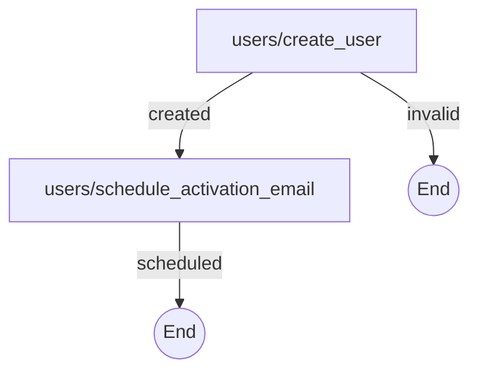
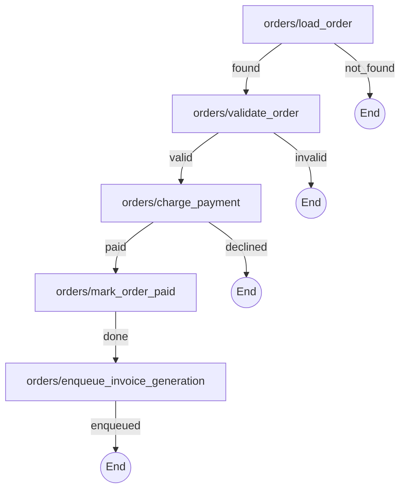

# SyncTraverse


**Explicit control flow for synchronous processes in Rails, built and maintained by an AI agent
through MCP.**

A synchronous process, i.e. the code that runs after any Ruby entrypoint is called (a controller
action, background job, webhook handler, rake task etc.), becomes an explicit graph of small
actions. The agent edits it only through an MCP server that validates the graph and runs the tests.

> [!WARNING]
> **Experimental.** This is a side project exploring AI agents and MCP in Rails development. Don't
> use it in production. It's not published on RubyGems, and while the version is `0.x` anything can
> change between releases.

## Why

Business logic in Rails apps tends to end up in fat controllers and service objects: early returns,
rescues and side effects all mixed together. When an AI agent changes code like that, you get a diff
that looks fine, but it's hard to tell what actually happened to the process.

SyncTraverse makes the agent work in a more structured way:

- every process (what happens after a controller action, job or webhook is called) is a **flow**,
  a small JSON graph of steps,
- every step is an **action**: a tiny class in its own directory, with its own tests,
- the agent changes flows and actions **only through an MCP server** that rejects broken graphs
  and runs the tests,
- every flow gets a generated **Mermaid diagram**, so in a pull request you review the process, not
  just the code.

Flows are **synchronous**: a flow describes only what runs in the current Ruby process, from the
moment it is called until it returns a result. Background work is just a step that hands it off
(for example `enqueue_invoice_generation`) and belongs to another flow.

## How it works

A flow maps every result of an action to the next action, or to `null` to finish:

```json
{
  "orders/charge_payment": { "paid": "orders/mark_order_paid", "declined": null },
  "orders/mark_order_paid": { "done": null }
}
```

An action is a class with a single `self.call(context)` method. It reads and writes a shared
`context` hash and returns one of the symbols listed in its `RESULTS` constant (see
[Example 1](#example-1-refactoring-a-controller)).

You run a flow from a controller, a job or anywhere else, and branch on the returned result:

```ruby
result = SyncTraverse::Runner.call("orders/purchase", { order_id: params[:id] })
```

Where things live:

```text
app/actions/orders/charge_payment/action.rb    # plus models, API clients etc. used only by this action
app/flows/orders/purchase/definition.json
app/flows/orders/purchase/definition.mmd       # generated diagram
test/actions/orders/charge_payment/test.rb
test/flows/orders/purchase/test.rb
```

## Installation

You need Ruby 3.0+, a Rails app and GitHub Copilot or Claude Code.

```ruby
# Gemfile
gem "sync_traverse", github: "piasekhgw/sync_traverse"
```

```bash
bundle install
bundle exec sync_traverse install copilot   # or: claude
```

This generates `.mcp.json`, the agent definition (in `.github/agents/` or `.claude/agents/`) and a
short section in `AGENTS.md`. Then pick the *Sync Traverse Designer* agent and describe what you
need.

## Example 1: refactoring a controller

> The examples are illustrative and shortened for the README.

Before:

```ruby
class UsersController < ApplicationController
  def create
    @user = User.new(user_params)

    unless @user.save
      render :new, status: :unprocessable_entity
      return
    end

    ActivationMailer.with(user: @user).activation_email.deliver_later
    redirect_to root_path, notice: "Check your inbox to activate your account."
  end
end
```

Prompt:

> Refactor UsersController#create into the flow users/register and wire it into the controller.

The agent splits the method into two actions. The early return becomes the `invalid` result:



```ruby
# app/actions/users/create_user/action.rb
module Users
  module CreateUser
    class Action
      RESULTS = %i[created invalid].freeze

      def self.call(context)
        user = User.new(context[:user_params])

        if user.save
          context[:user_id] = user.id
          :created
        else
          context[:errors] = user.errors.full_messages
          :invalid
        end
      end
    end
  end
end
```

The controller after:

```ruby
class UsersController < ApplicationController
  def create
    context = { user_params: user_params.to_h }

    case SyncTraverse::Runner.call("users/register", context)
    when :scheduled
      redirect_to root_path, notice: "Check your inbox to activate your account."
    when :invalid
      @errors = context[:errors]
      render :new, status: :unprocessable_entity
    end
  end
end
```

The original logic is copied into the actions (with their own `User` model and mailer), not
wrapped. The old code stays untouched until you decide to remove it. The agent also writes tests
for both actions and for the whole flow.

## Example 2: a new flow

Prompt:

> Create the flow orders/purchase, called from OrdersController#purchase. Load the order of the
> current user, check that it can be purchased, charge the customer through Stripe, mark the order
> as paid and enqueue the invoice generation.

The agent saves the graph first, then implements every action with tests and runs `run_tests` until
everything is green:



Loading data, validation, an API call, a database write and enqueuing a job are separate actions,
so every decision is visible on the diagram. The controller handles each way the flow can end:

```ruby
def purchase
  context = { order_id: params[:id], user_id: current_user.id }

  case SyncTraverse::Runner.call("orders/purchase", context)
  when :enqueued  then redirect_to order_path(params[:id]), notice: "Payment received."
  when :not_found then head :not_found
  when :invalid   then redirect_to cart_path, alert: context[:errors].to_sentence
  when :declined  then redirect_to checkout_path, alert: context[:decline_reason]
  end
end
```

## Rules

When the agent saves a flow, it is rejected unless:

- it has no cycles and exactly one start action,
- every action has at least one result and every target is an action of the flow,
- no two actions end the flow with the same result, so the caller always knows how it ended.

`run_tests` then checks that the results in the flow match `RESULTS` of every action, and runs the
action and flow tests. Actions never call each other: order and branching live only in the graph.

### Design choices

- **The agent writes only through MCP tools.** A broken graph is never saved and the diagram is
  always up to date.
- **Isolation over DRY.** An action may use only its own directory, gems and the database, never
  other app code or other actions. The price is deliberate duplication: models, clients and helpers
  are copied into each action that needs them. In return, everything needed to understand, change
  or test an action is in one directory, which keeps the agent's context small and changes local.
  Logic worth sharing becomes a separate action in the graph, not a helper module.
- **Plain data in `context`.** Flows take ids and params and return plain values, not ActiveRecord
  models from the rest of the app, so a flow doesn't depend on the rest of the code base.

## MCP tools and CLI

| Tool | What it does |
| --- | --- |
| `get_flow` | Reads a flow definition and its tests. |
| `update_flow` | Validates and saves a flow, regenerates its diagram, writes flow tests. |
| `get_action` | Reads the files and tests of an action. |
| `update_action` | Writes or deletes the files and tests of an action. |
| `run_tests` | Checks every flow against its actions and runs all action and flow tests. |

```text
sync_traverse install copilot|claude   # generate the agent and MCP config
sync_traverse mcp                      # start the MCP server (used by the agent)
sync_traverse test                     # run all checks and tests, e.g. on CI
```

## Limitations

- The agent is *told* to use only the MCP tools; nothing technically stops it from editing files
  directly.
- No loops, parallel steps or nested flows.
- `context` is a plain hash: if one action changes the keys it writes, only flow tests will notice.

## Development

```bash
bundle exec rake test
bundle exec rubocop
```

## License

[MIT](LICENSE.txt)
